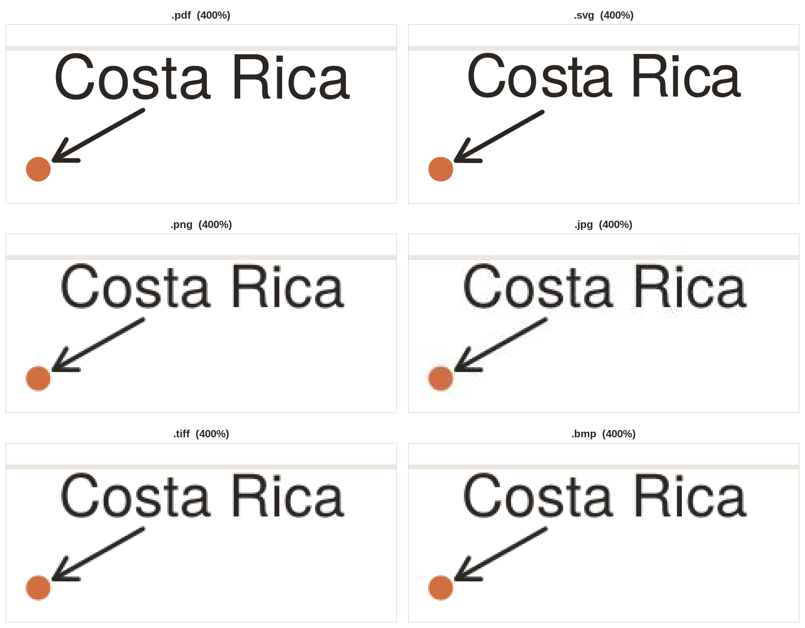

```{r}
#| label: setup
#| include: false
library(ggplot2)
source("scripts/assignment5/eric_style.R")
```

## Overview

In this assignment I drew the same set of charts twice: first with only the base `graphics` and `grDevices` packages, and then with ggplot2. After that, I exported one chart in six file formats and compared them. All charts use the 2024 extract of the Happy Planet Index (153 countries), which I also used in [Assignment 2](assignment2.qmd).

The six charts tell one story in order: how HPI scores are distributed, which regions score highest, how much countries differ inside each region, and finally how life satisfaction relates to ecological footprint.

## My chart style

Instead of R's defaults, I defined one personal style and used it for every chart. It has a clean, modern layout with a warm colour palette: a sans-serif font, one burnt-orange accent colour (`#C8551E`), warm dark-grey text, light horizontal gridlines, no box around the plot, and a left-aligned title. The same file contains `my_par()` for base graphics, which returns the old settings so that I can restore them with `par(op)`, and `theme_mine()` for ggplot2, which is built on `theme_minimal()`. This way, both sets of charts share the same colours and fonts.

```{r}
#| label: style-code
#| eval: false
#| code-fold: true
#| code-summary: "Show eric_style.R"
#| file: scripts/assignment5/eric_style.R
```

## Part 1. Base graphics

Every chart below uses only functions from `graphics` and `grDevices`. Each one has a title, labelled axes, a legend or an explanation whenever colour carries meaning, and a source note. All of them also use low-level functions such as `text()`, `abline()`, `arrows()`, `mtext()` and `legend()` for annotation.

### a. Histogram

The light bars show most countries, while the dark bars highlight the only three countries with an HPI of 60 or more. I added a density curve, a rug (one tick for each country), and the mean and median. The two lines almost overlap, so I placed their labels on opposite sides, and the subtitle explains that this means the distribution is roughly symmetric.

```{r}
#| label: fig-p1-hist
#| fig-cap: "Histogram of HPI scores (base graphics)."
#| file: scripts/assignment5/part1_a_histogram.R
```

### b. Bar chart

Both bar charts show the mean HPI of each region, sorted from highest to lowest. Darker bars are above the all-country average, and the dashed reference line is drawn behind the bars so that it does not cross the numbers.

#### i. Vertical

```{r}
#| label: fig-p1-bar-v
#| fig-cap: "Vertical bar chart of mean HPI by region (base graphics)."
#| file: scripts/assignment5/part1_b1_bar_vertical.R
```

#### ii. Horizontal

I prefer the horizontal version, because it is read naturally from top to bottom and it has enough space for the full region names and the number of countries in each region.

```{r}
#| label: fig-p1-bar-h
#| fig-cap: "Horizontal bar chart of mean HPI by region (base graphics)."
#| file: scripts/assignment5/part1_b2_bar_horizontal.R
```

### c. Pie chart

The pie chart shows each region's share of the total population. Eight slices were too many, so I kept the six largest regions and grouped the two smallest as "Other", which is drawn in grey. The colours come from my own palette instead of R's default pastel colours.

```{r}
#| label: fig-p1-pie
#| fig-cap: "Pie chart of population share by region (base graphics)."
#| file: scripts/assignment5/part1_c_pie.R
```

### d. Boxplot

The bar chart only shows averages, so the boxplot shows the spread inside each region. Each dot is one country, the white diamond is the mean, the orange line is the median, and the best country in every region is labelled.

```{r}
#| label: fig-p1-box
#| fig-cap: "Boxplot of HPI by region with every country shown (base graphics)."
#| fig-height: 4.3
#| file: scripts/assignment5/part1_d_boxplot.R
```

### e. Scatterplot

This bubble chart compares ecological footprint with life satisfaction. The size of each bubble shows population, and Latin American countries are highlighted in orange. Most of them reach high life satisfaction with a footprint of only about 2–3 global hectares per person.

```{r}
#| label: fig-p1-scatter
#| fig-cap: "Bubble chart of ecological footprint and life satisfaction (base graphics)."
#| fig-height: 4.3
#| file: scripts/assignment5/part1_e_scatter.R
```

## Part 2. ggplot2

I recreated the same six charts in ggplot2 with `theme_mine()`. Under each chart, I explain which system made the chart easier to produce and why.

### a. Histogram

```{r}
#| label: fig-p2-hist
#| fig-cap: "Histogram of HPI scores (ggplot2)."
#| file: scripts/assignment5/part2_a_histogram.R
```

I found ggplot2 easier for this chart. To colour the bars above 60, I only needed one line, `aes(fill = after_stat(x >= 60))`, and the density curve could be changed into counts inside `geom_density()`. In base R, I had to run `hist()` two times, choose the colour of each bar by myself, and multiply the density by the number of countries and the bin width.

### b. Bar chart

```{r}
#| label: fig-p2-bar-v
#| fig-cap: "Vertical bar chart of mean HPI by region (ggplot2)."
#| file: scripts/assignment5/part2_b1_bar_vertical.R
```

```{r}
#| label: fig-p2-bar-h
#| fig-cap: "Horizontal bar chart of mean HPI by region (ggplot2)."
#| file: scripts/assignment5/part2_b2_bar_horizontal.R
```

Both systems made the basic bars quickly, but ggplot2 was easier for the horizontal chart because I only had to swap the x and y variables. In base R, `barplot(horiz = TRUE)` draws the bars from the bottom to the top, so I had to reverse the data with `rev()` to put the highest region first. In both systems the long region names were a problem in the vertical chart, which is the main reason why I prefer the horizontal version.

### c. Pie chart

```{r}
#| label: fig-p2-pie
#| fig-cap: "Pie chart of population share by region (ggplot2)."
#| file: scripts/assignment5/part2_c_pie.R
```

Base R was clearly the winner here, because `pie()` is a single function and it already has options such as `clockwise` and `init.angle`. ggplot2 does not have a pie chart function, so I had to build one stacked bar and turn it into a circle with `coord_polar()`. I also had to reverse the order of the slices and calculate the position of every percentage label by myself.

### d. Boxplot

```{r}
#| label: fig-p2-box
#| fig-cap: "Boxplot of HPI by region with every country shown (ggplot2)."
#| fig-height: 4.3
#| file: scripts/assignment5/part2_d_boxplot.R
```

ggplot2 was easier, because the jittered points, the mean diamonds and the country labels are just extra layers that line up with the regions automatically. In base R, I had to remember that the *i*-th box is drawn at *y = i* and place every point and label by hand. An interesting difference is that the whiskers are not the same: `boxplot()` uses Tukey's hinges, while `geom_boxplot()` uses quantiles. As a result, Costa Rica (66.8) is inside the whisker in base R (upper limit 66.77) but becomes an outlier in ggplot2 (upper limit 66.54).

### e. Scatterplot

```{r}
#| label: fig-p2-scatter
#| fig-cap: "Bubble chart of ecological footprint and life satisfaction (ggplot2)."
#| fig-height: 4.3
#| file: scripts/assignment5/part2_e_scatter.R
```

For the bubbles, ggplot2 was easier, since `scale_size_area()` makes the area of each bubble match the population automatically. However, base R was easier for the arrows, because `strwidth()` and `strheight()` told me exactly where each label ends, so the arrows could start at the edge of the text. In ggplot2 the size of the text is not known in data units, so I had to move the arrows by trial and error.

### Overall

In general, ggplot2 was faster when a chart had several layers linked to the data, such as highlighted bars, grouped points or a size legend. On the other hand, base R was quicker for simple chart types like the pie chart and for annotations that need exact positions.

## Part 3. Output formats

I exported the bubble chart from Part 1 and its ggplot2 version at the same physical size, 6.5 × 4 inches, with 300 dpi for the raster formats. The base chart uses the device functions, each closed with `dev.off()`, and the ggplot2 chart uses `ggsave()`.

```{r}
#| label: export-code
#| eval: false
#| code-fold: true
#| code-summary: "Show part3_export.R"
#| file: scripts/assignment5/part3_export.R
```

**Download the files:**
base graphics —
[.pdf](files/assignment5/part3_output/scatter_base.pdf) ·
[.svg](files/assignment5/part3_output/scatter_base.svg) ·
[.png](files/assignment5/part3_output/scatter_base.png) ·
[.jpg](files/assignment5/part3_output/scatter_base.jpg) ·
[.tiff](files/assignment5/part3_output/scatter_base.tiff) ·
[.bmp](files/assignment5/part3_output/scatter_base.bmp);
ggplot2 —
[.pdf](files/assignment5/part3_output/scatter_ggplot.pdf) ·
[.svg](files/assignment5/part3_output/scatter_ggplot.svg) ·
[.png](files/assignment5/part3_output/scatter_ggplot.png) ·
[.jpg](files/assignment5/part3_output/scatter_ggplot.jpg) ·
[.tiff](files/assignment5/part3_output/scatter_ggplot.tiff) ·
[.bmp](files/assignment5/part3_output/scatter_ggplot.bmp)

### Comparison table

```{r}
#| label: tbl-formats
#| tbl-cap: "The six formats compared. File sizes come from file.size()."
sizes <- read.csv("files/assignment5/part3_sizes.csv")
names(sizes) <- c("Format", "Vector or raster", "Lossless or lossy",
                  "Transparency", "Base size (KB)", "ggplot2 size (KB)")
knitr::kable(sizes, format.args = list(big.mark = ","))
```

The PDF is by far the smallest file, because it only stores drawing instructions (circles, lines and text) instead of millions of pixels. The SVG is also a vector file, but it is larger than the PDF because it is plain text and R saves every letter as a separate path. TIFF and BMP are almost exactly 1950 × 1200 pixels × 3 bytes, because R saves them without any compression. PNG holds the same pixels but compresses them without losing anything, so it is many times smaller.

### Zooming to 400%

{fig-alt="Six close-ups of the same label and arrow. The PDF and SVG versions are perfectly sharp; the PNG, TIFF and BMP versions show small pixel steps; the JPG version also shows faint noise around the text and the orange circle."}

- **PDF and SVG:** The text and lines stay perfectly sharp at any zoom level, because the viewer redraws the shapes at the new size. In the PDF the label is still real text that can be selected and searched, while in the SVG the letters have become outlines.
- **PNG, TIFF and BMP:** These three look exactly the same, which shows that all of them are lossless. At 400% the edges of the letters, the arrow and the circle become small steps, with a soft grey edge from anti-aliasing. The chart is still easy to read, but it is clearly made of pixels.
- **JPG:** It has the same blocky edges and also extra noise: a faint "halo" of grey dots around the letters and a light orange shadow around the circle. These are compression artefacts, because JPEG throws away detail to save space. It works well for photos, but it is a poor choice for charts with sharp text and thin lines.

### Which format for which destination?

- **Journal article → PDF.** It is vector, so it stays sharp at any print size, the file is tiny, and the text remains real text. If a journal only accepts raster images, I would send a 300 dpi TIFF instead, because it is lossless and widely accepted for printing.
- **Web page → SVG (or PNG).** Modern browsers display SVG directly, and it stays sharp on high-resolution screens and when readers zoom in. PNG is a safe backup because every browser supports it and it keeps sharp edges. I would avoid TIFF and BMP, as they are huge and most browsers cannot show TIFF at all.
- **PowerPoint slide → PNG at 300 dpi.** PowerPoint handles PNG perfectly, and a transparent background makes it easy to place on coloured slides. Newer versions of PowerPoint can also insert SVG, which would be even sharper, but PNG is the safest choice if the slides are opened on different computers.

## Reflection: When is a pie chart the right choice?

Murrell includes `pie()` in *R Graphics* as a standard plot, but he admits that it is not popular. Cleveland and McGill (1984) explain why. They ranked ten elementary perceptual tasks, and judging angle and area comes after judging position along a common scale. In their experiment, people judged position 1.96 times as accurately as angle, and the pie chart was more accurate than the bar chart in only 3 of 40 cases.

My own pie chart shows the same problem. Eight regions were difficult to read, so I kept the six largest and grouped the rest as "Other". Even so, Latin America (8%), the Middle East and North Africa (7%) and Western Europe (6%) look almost identical, and readers can only compare them by reading the labels. On the other hand, it is still easy to see that East Asia and South Asia together make up more than half of the world's population.

Therefore, I think a pie chart is acceptable only when the message is a part-to-whole relationship with a few slices and a rough comparison, such as "about half". When readers need to compare similar values, a sorted bar chart is a better choice.

## References

Cleveland, William S., and Robert McGill. 1984. "Graphical Perception: Theory, Experimentation, and Application to the Development of Graphical Methods." *Journal of the American Statistical Association* 79 (387): 531–554.

Global Footprint Network. Biocapacity of 1.6 global hectares per person (2016 data), as reported in "Biocapacity," *Wikipedia*. <https://en.wikipedia.org/wiki/Biocapacity>

Hot or Cool Institute. 2026. *Happy Planet Index 2006–2025 Public Data Set*. <https://happyplanetindex.org/countries/>

Murrell, Paul. 2019. *R Graphics*. Third edition. Boca Raton: Chapman & Hall/CRC.

## AI Use Statement

I used Claude (Anthropic) for this assignment. Claude summarised the assigned Murrell chapters, proposed several style and chart options for me to choose from, wrote the R code for the charts and the export script, and drafted the English text, which I asked to be written at about an IELTS 6.5 level. The design decisions were mine: I chose the warm colour style, selected and combined the chart versions, asked for specific changes (for example, adding the rug and median to the histogram, the mean diamonds to the boxplot, and simplifying the bubble chart labels), and checked every chart before accepting it. The full log is here: [Assignment 5: AI Use Log](ai-log-assignment5.qmd).
